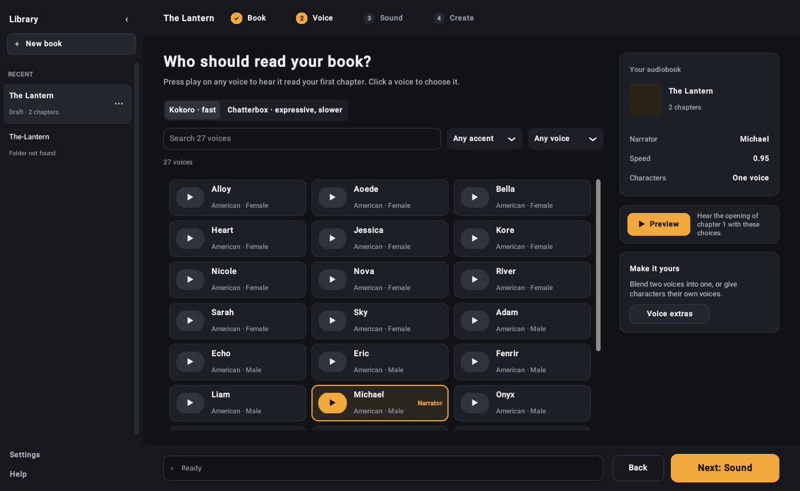

# Audiobook Maker

Turn a book into an audiobook on your own computer, for free. Choose your chapters (or import an EPUB, Word or PDF
file), pick a voice, and the app narrates the book into an .m4b audiobook with chapter markers and cover art. It can
also export one MP3 per chapter. Everything runs offline once the voices have downloaded.

- **Two voice engines.** Kokoro is fast, with 27 American and British voices that can be blended. Chatterbox is slower
  and more expressive, and can copy a voice from a 10-second clip.
- **Character voices.** With Kokoro, dialogue can be read in a different voice for each character.
- **Pronunciations, pauses and scene breaks** you can adjust per book.
- **Skipped-word check.** With Chatterbox, Whisper listens to each paragraph and narrates it again if words are missing.
- **Even volume** that meets audiobook store loudness levels (ACX).
- **Library and player** with resume, speed control and chapter jumping.
- **Gentle mode** for laptops without a fan.



## Download

Get `Audiobook-Maker-<version>-mac-arm64.dmg` from the Releases page. It needs a Mac with Apple silicon (M1 or newer)
and macOS 12 or later, plus about 4 GB of disk for the voices, which download the first time each one is used.
Books in English only, for now.

1. Open the .dmg and drag **Audiobook Maker** into **Applications**.
2. The app is free and isn't signed with a paid Apple developer account, so macOS blocks it the first time. Open
   **System Settings → Privacy & Security**, scroll down to Security and click **Open Anyway** next to
   Audiobook Maker. After that it opens normally.

The download includes FFmpeg and everything else the app needs; nothing else to install.

## Run from source (Mac)

Needs Python 3.11, [uv](https://docs.astral.sh/uv/), and FFmpeg and espeak-ng from Homebrew.

```bash
brew install ffmpeg espeak-ng
git clone <this repository> audiobook-maker
cd audiobook-maker
uv venv --python 3.11 .venv
uv pip install --python .venv/bin/python -r requirements.txt
.venv/bin/python gui.py
```

Or double-click **Audiobook Maker.app** in the project folder. To open it from the Dock or Applications, drag an alias
of it there rather than moving it. To build the .dmg yourself, see [packaging/README.md](packaging/README.md).

## Run from source (Windows, untested)

1. Install Python 3.11 and [uv](https://docs.astral.sh/uv/), then FFmpeg: `winget install Gyan.FFmpeg`
2. In PowerShell, in the project folder:
   ```powershell
   uv venv --python 3.11 .venv
   uv pip install --python .venv\Scripts\python.exe -r requirements.txt
   ```
3. Double-click **Audiobook Maker.bat**.

With an NVIDIA graphics card, Chatterbox uses it automatically.

## Where files go

A fresh install keeps its own files (saved narration, previews, recorded voices and settings) in the app data folder,
and saves audiobooks to **Music/Audiobook Maker**. A copy that was already in use keeps everything in its project
folder, as before. Each book's settings are saved next to its chapters, in `audiobook-settings.json`.

## Privacy

No account and no tracking. Your books, voice recordings and audiobooks stay on your computer. The app goes online for
two things: downloading the voice models from Hugging Face the first time each one is used (with Hugging Face's usage
reporting turned off), and asking GitHub once a day whether a new version is out (Settings → Check for updates turns
that off). **Settings → Download all voices** fetches every voice at once so they all work offline.

## Voice models and licences

| Model | Licence | Notes |
|---|---|---|
| [Kokoro-82M](https://huggingface.co/hexgrad/Kokoro-82M) | Apache-2.0 | About 330 MB with all voices |
| [Chatterbox](https://huggingface.co/ResembleAI/chatterbox) | MIT | About 3 GB. Every clip it makes carries Resemble AI's inaudible Perth watermark, which software can detect as AI-made |
| [Whisper small.en](https://huggingface.co/Systran/faster-whisper-small.en) (faster-whisper) | MIT | About 480 MB, for the skipped-word check |

## Using it

Open **Help** at the bottom of the library pane for step-by-step guides to every feature. `help.md` has the same text.

There is also a command line: `.venv/bin/python audiobook.py --help`.

## Voice cloning

Chatterbox can copy a voice from a short clip. Only use your own voice, or the voice of someone who has agreed to it.

## Development

```bash
uv pip install --python .venv/bin/python -r requirements-dev.txt
.venv/bin/python -m pytest
ruff check .
```

The tests fake narration, so they don't need the voice models. GitHub Actions runs them, the linter and an app-opens
check on every pull request.

The code: `gui.py` is the window, with one module per part (`book_step.py`, `voice_step.py`, `sound_step.py`,
`create_step.py`, `library_actions.py`, `runner.py`). `audiobook.py` does the narrating and building, `cast.py` finds
who is speaking, `checker.py` runs the skipped-word check, `importer.py` reads EPUB, Word and PDF, and `library.py` and
`player.py` back the library and the player.

## Licence

GPL-3.0 (see LICENSE). Kokoro depends on GPL-licensed parts (espeak-ng, phonemizer), so the app is GPL too: you can
use, change and share it, and copies you share must stay open source under the same licence.

Copyright © 2026 sushi_samurai. The software it's built on, and their licences, are listed in
[THIRD-PARTY-NOTICES.md](THIRD-PARTY-NOTICES.md).
